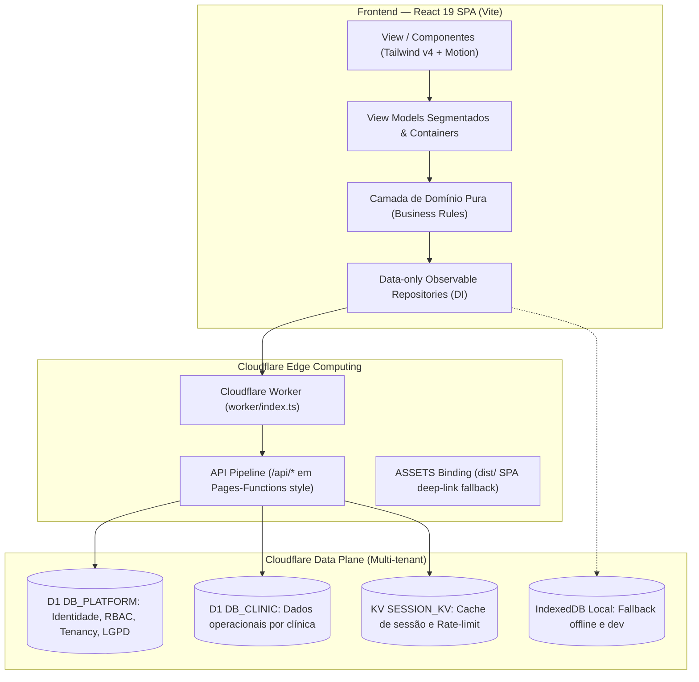

# 📅 Projeto 11 — AGENDA (Appione SaaS de Gestão de Clínicas)

> **Caminho no Sistema:** `C:\Users\Gus\Documents\Projetos\AGENDA`  
> **Nome Comercial:** **Appione** (União de *App* + *Epione*, deusa grega do cuidado e alívio da dor)  
> **Repositório GitHub:** `DanielGunna/AGENDA`  
> **Stack:** React 19, Tailwind CSS v4, Motion, Vite, Cloudflare Workers, Cloudflare D1, KV, Playwright, Vitest

---

## 🎯 Visão Geral do Produto

O **Appione** é uma plataforma SaaS *whitelabel* completa para gestão de clínicas de saúde e psicologia:
- **Calendário Interativo:** Agendamento drag-and-drop de consultas com alta velocidade e suporte a repetição.
- **Prontuários e Pacientes:** Gestão de pacientes, carteirinhas, convênios (Unimed, etc.) e profissionais de saúde.
- **Painel Financeiro & Fechamento:** Controle de produção médica, saldos a faturar, guias e comissões.
- **Whitelabel Nativo:** Cada clínica cliente possui sua própria marca, logotipo, cores, terminologia e banco de dados isolado.

---

## 🏗️ Topologia da Arquitetura

O projeto é monorepo com duas camadas fortemente integradas que realizam deploy conjunto:

---

## ⚙️ Modos de Persistência em Tempo de Execução

1. **Modo Local (IndexedDB):**
   - Mantém os dados isolados no IndexedDB do navegador por namespace de marca.
   - Padrão para desenvolvimento local (`npm run dev`) e testes automatizados.
2. **Modo Remoto (Cloudflare D1):**
   - Persistência nativa na borda através da API same-origin sob `/api`.
   - Isolamento estrito entre `DB_PLATFORM` (controle e autenticação) e `DB_CLINIC` (dados de saúde do cliente).
3. **Autenticação:**
   - Google Identity Services com sessões híbridas baseadas em cookie HTTP-only seguro.

---

## 📦 Scripts e Comandos Operacionais

| Comando | Descrição |
| :--- | :--- |
| `npm run dev` | Inicia o servidor local Vite na porta 3000 (`http://localhost:3000`) |
| `npm run build` | Compila o bundle de produção para `dist/` |
| `npm run test` | Roda a suíte de testes unitários com Vitest |
| `npm run test:workers` | Executa testes específicos dos Cloudflare Workers |
| `npm run test:e2e` | Roda testes end-to-end com Playwright |
| `npm run lint` | Validação estrita do TypeScript sem emissão de código |
