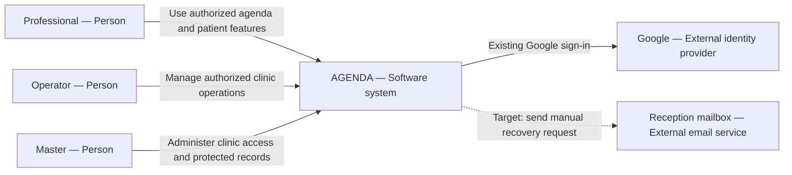
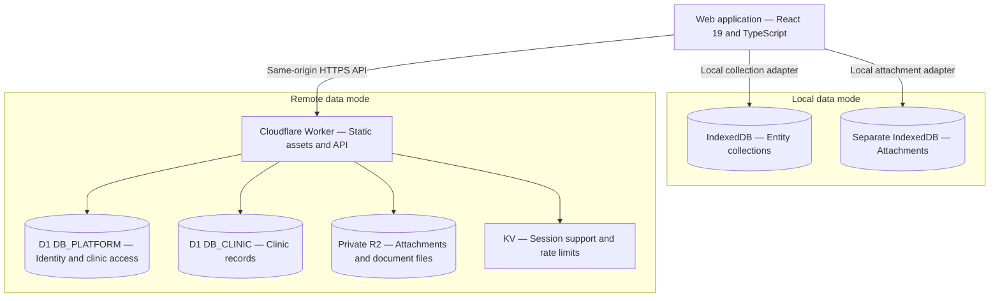
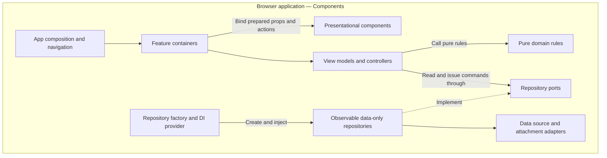
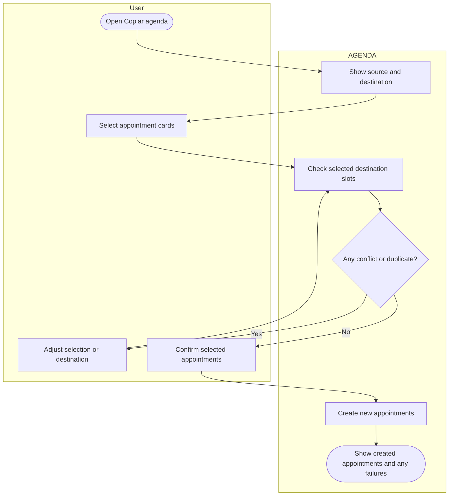
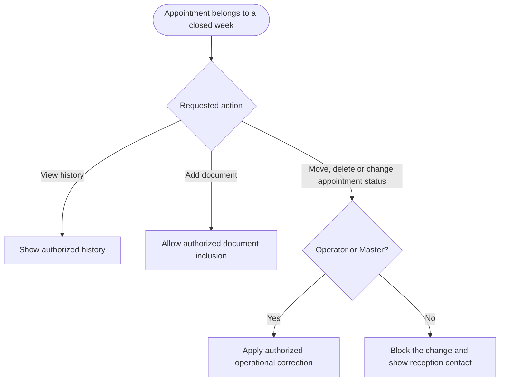
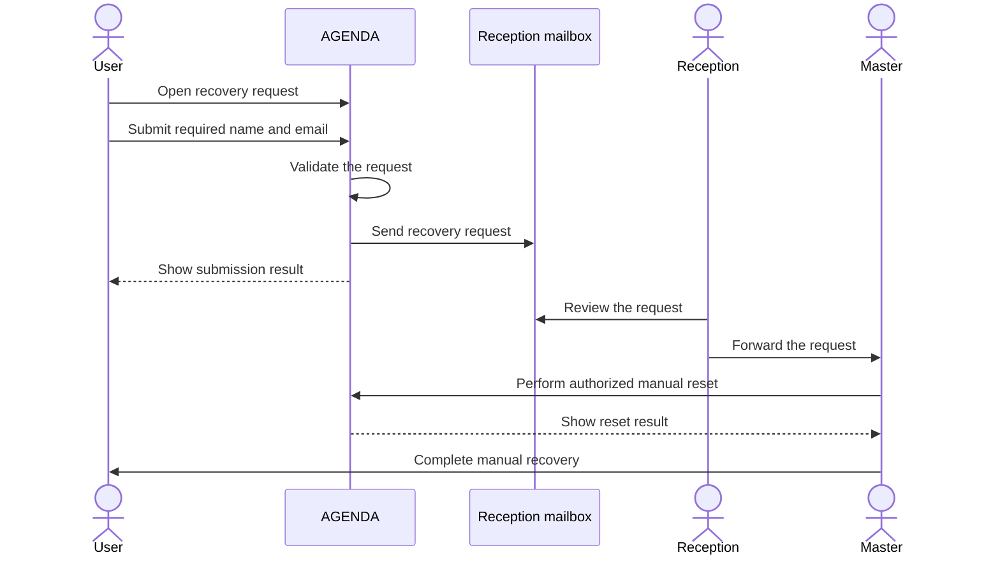

# AGENDA — Product Rules and Operational Guide

<!-- This document follows the ASD-STE100 Simplified Technical English standard. -->

**Document version:** 0.2  
**Date:** 2026-10-21  
**Status:** Ready for review  
**Interface language:** Brazilian Portuguese  
**Documentation language:** English

## 1. Purpose and reading order

This guide helps a person who is new to AGENDA understand its users, architecture, navigation,
business rules, and operating procedures.

Read sections 2 through 5 for orientation. Read sections 6 through 13 for the operating rules
and procedures. Read sections 14 through 17 for pilot acceptance, implementation differences,
and source references.

This guide separates two kinds of information:

- **Current architecture and routes:** facts checked in the local repository.
- **Target product behavior:** rules defined with the repository owner for release preparation.

A target rule in this guide is not proof that the application implements it. The document is
ready for review; the product has not passed a release gate as part of this documentation work.

The architecture views use the [C4 model](https://c4model.com/diagrams). The procedure diagrams
use [Mermaid flowcharts](https://mermaid.js.org/syntax/flowchart.html) and sequence diagrams.
The procedure flowcharts show BPMN-style events, tasks, decisions, and role lanes. They are
process instructions in Markdown, not a BPMN 2.0 interchange file.

## 2. Product boundary and ASPAC context

AGENDA covers:

- Patient and professional registration.
- Appointment scheduling and presence.
- Clinical documents and patient history.
- Patient counters and operational reports.
- Access control and administrative settings.

LUA and Eclipse are separate systems in the ASPAC operation. They supply context for this
guide. This guide specifies no integration between them and AGENDA. AGENDA must not query SOL,
perform billing operations, or import billing status into its workflows or reports.

The first pilot uses AGENDA and the old agenda in parallel for five professionals. Recording
appointments in both systems is a comparison procedure. It does not imply an automatic
connection between the systems.

### 2.1. How to use the ASPAC vault

The ASPAC notes describe the wider operation. The AGENDA notes describe the product and its
technical context. Use the notes as reference material and compare their architectural claims
with the repository before implementation.

The local vault root inspected for this guide is:

    C:/Users/Gus/Documents/Obsidian Vault

| Vault source | Use in this guide |
|---|---|
| 00_INDEX_OPERACIONAL_LUA_ECLIPSE.md | Locate the separate operational system and its canonical project |
| ASPAC / 00 - Visão Geral e Mapa do Ecossistema | Understand the wider ASPAC operation and system boundaries |
| ASPAC / 03 - Eclipse (Dashboard Web de Saldos SOL) | Identify Eclipse as an existing, separate operational application |
| ASPAC / 05 - Protocolo de Fechamento Redondo e Proteção de Planilhas | Understand the need to preserve records and human work |
| AGENDA / 00 - Visão Geral do Appione (AGENDA) | Identify the product, repository, and intended users |
| AGENDA / 01 - Arquitetura, Tecnologias e Cloudflare | Compare architectural notes with the current repository |

The project notes are under the vault's Projects folder, in the ASPAC and AGENDA project
folders. Local paths identify source material on the author's workstation. The application
does not require access to this vault.

The generated operational index inspected was dated 2026-10-17. Its operational totals are a
historical snapshot and are not copied into this guide.

Older notes that propose a shared database or a wider integration do not define the scope of
this release proposal. The product boundary above follows the owner's explicit decisions.

## 3. Users and permissions

A **Professional** uses the agenda and patient features within their authorized scope.

An **Operator** manages authorized clinic operations and can correct operational appointment
data after weekly closure.

The **Master** owns the highest clinic role. The existing technical role key remains
`clinic_admin`. This guide does not rename the stored role.

| Action | Professional | Operator | Master |
|---|---|---|---|
| View authorized appointments and history | Yes | Yes | Yes |
| Use **Copiar agenda** | Yes | Yes | Yes |
| Change appointments in a closed week | No | Yes | Yes |
| Add documents to their own closed appointments | Yes | According to existing document permissions | Yes |
| Read clinical document content | Only files they uploaded | No | All patient documents in their clinic |
| See permitted clinical document counters and availability | Within authorized scope | Yes | Yes |
| View health card front and back files | Under their file access scope | Yes | Yes |
| Execute a password reset | No | No | Yes |
| Receive and forward a recovery request | According to reception responsibility | Yes | Yes |

Permission to copy an appointment does not grant permission to edit the original appointment.
Viewing card images does not grant access to other protected clinical files.

Authorization must apply to the API and direct file requests as well as to visible controls.
An operator must not obtain clinical content through a filename, private storage key, preview,
download action, or direct URL.

## 4. Architecture

### 4.1. C4 Level 1 — AGENDA context

Professionals, operators, and the Master use AGENDA. Google supplies an existing sign-in
method. The reception mailbox receives the proposed manual recovery requests.



*Figure 1. AGENDA context. The dotted relationship is target behavior.*

Email and password sign-in must use the same account and clinic access rules as Google
sign-in. AGENDA account recovery does not change the user's Google account.

### 4.2. C4 Level 2 — Repository-supported containers

The repository supports local and remote data modes. These are configured modes. This diagram
does not describe automatic synchronization between them or establish which mode is active
in production.



*Figure 2. Application and storage boundaries supported by the current repository.*

Local collection storage is namespaced by the active brand. Binary attachments use a separate
storage adapter and database. In remote mode, the Worker serves the SPA and dispatches API
requests through the existing request pipeline.

The current selection code defaults to local mode unless remote mode is configured.
`LocalStorageDataSource` is not the active local collection adapter.

### 4.3. C4 Level 3 — Browser application components

Shared domain data passes through observable repositories and repository ports. View models
and controllers coordinate pure business rules. Presentational components receive prepared
data and actions.



*Figure 3. Component responsibilities inside the browser application.*

Do not put a domain rule in a container, presentational component, repository, or storage
adapter. Keep shared entities and cross-feature vocabulary in the domain kernel. Features
share data through repository ports rather than importing each other.

## 5. Navigation and entry points

The following routes and view query values exist in the inspected application structure.
Access remains subject to the user's permissions.

| Entry point | Purpose |
|---|---|
| `/` | Public product page |
| `/sobre` | Public information page |
| `/login` | Sign-in page |
| `/app?view=day` | Daily calendar |
| `/app?view=week` | Weekly calendar |
| `/app?view=records` | Registration records |
| `/app?view=free-slots` | Available appointment slots |
| `/app?view=first-consultations` | First-consultation list |
| `/app?view=overview` | Operational overview |
| `/app?view=settings` | Settings |

The protected application route is `/app/*`. The query parameter selects an application
view; these values are not separate API endpoints.

The patient profile opens from the patient records or another authorized patient action.
It contains registration data, appointment history, evolutions, and attachments.

Existing history links can identify the appointment date, unit, and highlighted appointment.
Preserve that navigation when the mobile calendar switches to the daily view.

The report catalog in section 13 defines target behavior. This route table does not claim
that report pages, the copy modal, or the manual recovery flow already exist.

## 6. Patient registration

### 6.1. Unimed card number and search

**PAT-01:** A patient registered under Unimed must have a health card number.

**PAT-02:** A private patient can be registered without a health card number.

**PAT-03:** Patient search must support the health card number. Preserve the number as text,
including leading zeros.

### 6.2. Optional card files

**PAT-04:** Provide two optional attachment slots:

- **Frente da carteirinha**
- **Verso da carteirinha**

Each slot accepts an image or PDF. The files are optional even when the card number is
required.

**PAT-05:** Operators can view these front and back files. This exception is limited to the
card slots. It does not grant permission to read clinical documents.

### 6.3. Need for representation

**PAT-06:** The registration and patient profile must identify whether the patient needs
another person to represent them.

This condition is independent of age. An adult can also need representation. Do not derive
this condition only from the patient's birth date or health plan dependency.

## 7. Calendar and patient counters

### 7.1. Mobile calendar

**CAL-01:** On mobile devices, the calendar must use the daily view.

Preserve the selected date and the user's authorized scope during navigation. The copy
preview must also remain readable on mobile and show one day at a time.

### 7.2. Patient counters

**MET-01:** The patient profile must show:

- Appointments in the month in view.
- Absences in the month in view.
- Total appointments.
- Total absences.
- Document and file counters by type.

**MET-02:** Appointment counters include registered appointments, rather than only completed
consultations. Absences appear separately. Monthly counts use the appointment date.

**MET-03:** Opening a copy preview or selecting cards does not create appointments and does
not change counters. Successfully created copies enter the counts for their destination dates.

**MET-04:** Cancellation and absence remain separate presence statuses. Reports must identify
the status behind a count rather than treating every scheduled entry as a completed
consultation.

Counters and history must respect the user's authorized data scope.

## 8. First-consultation rule

**FIRST-01:** The default interval is **90 days**.

**FIRST-02:** The interval must be editable in administrative settings.

**FIRST-03:** Classification considers the patient's last completed consultation across the
entire clinic. It is not restricted to the same professional.

**FIRST-04:** An absence does not restart the interval.

**FIRST-05:** A change to the configured interval applies only to appointments created after
that change. The setting change alone must not reclassify existing appointments, including
appointments already scheduled for future dates.

**FIRST-06:** An appointment created through **Copiar agenda** is a new appointment. Its
classification uses the configuration applicable to its creation. Do not copy the previous
appointment's classification as a fixed value.

Imported and historical classifications must remain preserved. Clinic-wide classification
must not expose appointment details that the requesting user cannot otherwise read.

## 9. Documents and discreet reminders

### 9.1. Frequency and renewal

| Rule | Document | Frequency or renewal condition |
|---|---|---|
| DOC-01 | **Anamnese** | Once; a professional change requires a new document |
| DOC-02 | **Termo** | For patients who need representation; indefinite validity |
| DOC-03 | **Plano de trabalho** | Every six months or when the professional changes |
| DOC-04 | **Evolutivo** | For each consultation |

**DOC-05:** A new Commitment Term can be inserted only after the current Term is archived.
Archiving must preserve the previous document.

A professional change must not remove documents prepared during the previous professional
relationship. Document lifecycle actions remain subject to the existing protected-history
authorization rules.

### 9.2. Visibility

**DOC-06:** The Master can read all patient documents within their clinic.

**DOC-07:** Operators can see clinical document counters and whether a document or posting
exists. They cannot read the clinical content.

**DOC-08:** A professional can read only the files they uploaded. Preserve authorship when a
structured form creates a document version. Do not infer file ownership only from the
patient's current professional assignment.

**DOC-09:** The card front and back exception in PAT-05 does not extend to other files.

Apply these rules to previews, downloads, history lists, and direct artifact requests.

### 9.3. Reminders

**DOC-10:** Missing or due documents produce a compact, discreet indication. A reminder must
not prevent the appointment workflow or produce repeated popups.

**DOC-11:** An unavailable status request must not be presented as proof that no document
exists.

**DOC-12:** Preserve saved clinical facts. A correction creates an additional record or
version rather than overwriting previous content.

## 10. Procedure — Copy a day or week

### 10.1. Purpose and entry points

**COPY-01:** Make **Copiar agenda** available to professionals, operators, and the Master
within their authorized agenda scope.

Selecting a calendar date can expose:

- **Copiar este dia**
- **Copiar esta semana**

The source and destination periods must be visible before confirmation.

### 10.2. User procedure

1. Open the copy action.
2. Review the source and destination dates.
3. Select the appointment cards to copy.
4. Review the selected quantity and any destination conflicts.
5. Confirm with **Copiar N agendamentos**.
6. Review the actual result.

The preview presents a compact version of the source agenda. Each card has a clear selected
or unselected state. On mobile, show one day at a time with navigation between days.



*Figure 4. BPMN-style copy procedure represented with Mermaid role lanes.*

### 10.3. Copy behavior

**COPY-02:** Preserve the original appointments and their history.

**COPY-03:** Reuse the scheduling information required for the destination, including patient,
professional, unit, room, and time.

**COPY-04:** The new appointment starts as scheduled. It does not inherit the source
appointment's presence result or evolution content.

**COPY-05:** Existing patient documents remain associated with the patient without duplication.

**COPY-06:** Detect destination conflicts and prevent accidental duplicate creation.

**COPY-07:** A closed source week can be used as a model. Copying creates destination
appointments and does not edit the closed source records. Destination actions must respect
the user's permissions and the closure rule.

If creation fails, report the actual outcome. Do not present an unsuccessful or partially
successful operation as if every selected appointment was created.

### 10.4. Empty-week invitation

**COPY-08:** On the first access to an empty current week, present:

**Preparar esta semana**

> Quais pacientes da semana passada serão atendidos nesta semana?

The user can select cards or choose **Agora não**. The invitation appears once for that week.
**Copiar agenda** remains available for later use.

The empty-week check considers the complete authorized week, rather than only an empty
Monday or a filtered calendar result.

**COPY-09:** This procedure does not create six months or one year of appointments
automatically. Counters increase only when selected appointments are actually created.

## 11. Procedure — Weekly closure and protected history

**CLOSE-01:** The weekly closure includes the week through Sunday.

**CLOSE-02:** Professionals retain access to authorized historical appointments after closure.

**CLOSE-03:** For a professional, a closed appointment must prevent:

- Moving the card.
- Changing its date or time.
- Deleting the appointment.
- Changing its presence status.

**CLOSE-04:** Document inclusion remains permitted on the professional's own appointments.
This permission must preserve previous clinical content.

**CLOSE-05:** Operators and the Master can make authorized operational corrections to closed
appointments. That permission does not grant an operator access to clinical content.

**CLOSE-06:** When a professional attempts a blocked change, explain the restriction and
recommend contacting **recepcaoaspac@gmail.com**.



*Figure 5. Separate history access, document inclusion, and changes to closed appointments.*

Document inclusion after closure can update document availability and counters without
changing the appointment's date, time, or presence status.

## 12. Procedure — Sign-in and manual recovery

### 12.1. Sign-in methods

**AUTH-01:** The target sign-in page supports Google sign-in and email with password.

Both methods must respect the same account and clinic access rules.

### 12.2. Request submission

**AUTH-02:** The recovery action opens a modal with:

- **Nome** — required.
- **E-mail** — required.

**AUTH-03:** Submitting the modal sends a recovery request to **recepcaoaspac@gmail.com** for
manual handling. The requested user-facing flow does not send an automatic reset-token link.

**AUTH-04:** Report a submission failure accurately. Completing the fields is not, by itself,
proof that the request was sent.

The ASPAC recipient belongs in brand or deployment configuration.

### 12.3. Master execution

**AUTH-05:** Only the Master can execute the password reset. An operator can receive and
forward the request but cannot perform the reset.

The administrative action and its API authorization must enforce this restriction. Sending
a public request must not itself change a credential.



*Figure 6. Reception handles the request; only the Master performs the password reset.*

## 13. Required operational reports

All four reports below are required for the five-professional pilot.

| Report | Purpose | Required information |
|---|---|---|
| REP-01 — Agenda by period and professional | Review the appointments registered for the selected period and professional | Appointment date, time, patient, professional, unit, and presence status |
| REP-02 — Presence and absences | Compare appointment outcomes | Counts and authorized detail by presence status; keep absence and cancellation distinct |
| REP-03 — First consultations | Identify appointments classified under the first-consultation rule | Appointment date, patient, professional, and first-consultation classification |
| REP-04 — Document pending items | Identify required documents that are missing or due | Patient, applicable document type, availability, and pending condition within the user's permissions |

**REP-05:** Reports use AGENDA's own records. Each result must identify its period and applied
filters.

**REP-06:** Reports and patient counters must use consistent definitions for the same period,
scope, and status.

**REP-07:** A registered appointment is not proof of a completed consultation. Keep registered,
completed, missed, justified absence, and cancelled records distinguishable.

**REP-08:** The document report must respect document applicability. A patient who does not
need representation must not receive a missing-Term warning solely because no Term exists.

**REP-09:** Operators can see document counters, availability, and pending conditions without
clinical content. Professionals remain restricted to their authorized document scope. The
Master can review all authorized patient documents in the clinic.

These report requirements do not claim that a particular report page or export format is
already implemented.

## 14. Five-professional pilot

**PILOT-01:** Include five professionals in the initial pilot.

**PILOT-02:** Record their appointments in both AGENDA and the old agenda for comparison.

Use this procedure:

1. Confirm the participating professionals and their authorized clinic scope.
2. Check that the corresponding patient and professional registrations are identifiable.
3. Record the appointments in both agendas.
4. Compare dates, times, units, professionals, and presence records.
5. Exercise day and week copying, mobile navigation, document inclusion, and weekly closure.
6. Compare the requested patient counters and all four reports.
7. Record differences with reproducible steps and sanitized examples.
8. Review the evidence before extending the pilot.

Running the pilot does not authorize an automatic synchronization process.

## 15. Acceptance and release preparation

### 15.1. Acceptance map

| Rules | Required acceptance evidence |
|---|---|
| PAT-01 to PAT-05 | Unimed registration requires a card number; private registration accepts its absence; search finds the card number; optional front and back files are readable by operators |
| PAT-06 | A represented adult can be identified independently of age or health plan dependency |
| CAL-01 | Mobile calendar and copy preview remain usable in the daily view |
| MET-01 to MET-04 | Monthly and total counts use registered appointments and distinguish their presence outcomes; preview selection does not change counts |
| FIRST-01 to FIRST-06 | Clinic-wide completed history and the configured interval determine new classifications; absences do not restart the interval; changing settings preserves existing classifications |
| DOC-01 to DOC-12 | Frequency, applicability, protected versions, role access, and discreet non-blocking reminders behave as specified |
| COPY-01 to COPY-09 | Every role can copy within scope; source history remains intact; conflicts and duplicates are handled; only actual creations affect counts |
| CLOSE-01 to CLOSE-06 | Closed appointments remain readable; professional movement, deletion, and status changes are denied; authorized document inclusion remains possible |
| AUTH-01 to AUTH-05 | Both sign-in methods respect clinic access; the recovery modal requires name and email; only Master can execute the reset |
| REP-01 to REP-09 | All four reports are available for the pilot and use the authorized, consistent data definitions |
| PILOT-01 to PILOT-02 | Five professionals have comparison evidence from both agendas |

Write the relevant failing tests before implementation. Cover pure rules and at least one
instrumented level for each changed behavior.

### 15.2. Required checks

Run the repository gates for the implementation:

```text
npm run lint
npm run test
npm run test:e2e
npm run build
```

Backend changes must also run the applicable Worker tests.

Report the exact verification results before a merge or release. This guide does not
authorize a merge, deployment, database mutation, release tag, or production operation.

### 15.3. Evidence limits for this documentation step

This guide was prepared from repository inspection, the local vault context, and the owner's
decisions in the conversation.

No requested application behavior was implemented in this documentation step. No release
gate was executed, and production parity was not established.

A future implementation must follow the repository's specification, planning, task, and
test-first process. It must preserve unrelated contributor work.

## 16. Differences between current evidence and the target

| Area | Current repository evidence | Target behavior |
|---|---|---|
| Public sign-in | The visible sign-in page presents Google access | Also present email and password access |
| Recovery | Backend recovery code uses a reset-token flow | Present a request modal for manual handling; allow only Master to execute the reset |
| Patient search | Search does not include the health card number | Search by health card number |
| Patient model | Health card number is optional | Require it for Unimed patients |
| First consultation | Classification uses patient and professional history | Use clinic-wide completed history and a configurable interval |
| First-consultation settings | No interval field in the inspected settings model | Default to 90 days and allow changes for new appointments only |
| Initial calendar view | Application state defaults to the weekly view | Use the daily view on mobile |
| Clinical history permissions | Existing specification hides clinical metadata from operators | Provide permitted counters and availability, with the explicit card-image exception |
| Professional document access | Existing specification uses the originating appointment relationship | Apply the requested own-upload visibility rule |

The constitution contains older localStorage wording in Principle II, while its Stack
Constraints and the inspected local adapter selection identify IndexedDB. This guide records
the divergence and describes the verified adapter behavior. It does not change the
constitution.

These are review findings, not completed implementation tasks. This guide does not silently
replace an existing approved feature specification.

## 17. Repository references

| Source | Purpose |
|---|---|
| [Constitution](../.specify/memory/constitution.md) | Mandatory architecture and governance |
| [Repository agent instructions](../AGENTS.md) | Operating rules and source precedence |
| [Architecture guide](architecture.md) | Frontend structure and dependency boundaries |
| [Backend overview](backend/README.md) | API, identity, and storage context |
| [Application routes](../src/app/AppRouter.tsx) | Public and protected route boundaries |
| [Application navigation state](../src/app/AppProvider.tsx) | Current view and query handling |
| [Data source selection](../src/infrastructure/datasources/createDataSource.ts) | Local and remote adapters |
| [Worker entry point](../worker/index.ts) | Static assets and API dispatch |
| [Patient model](../src/domain/models/patient.ts) | Registration and attachment metadata |
| [Patient search](../src/features/records/domain/search.ts) | Existing search fields |
| [Patient counters](../src/features/records/domain/patientAppointments.ts) | Existing count definitions |
| [First-consultation rule](../src/domain/firstConsultation.ts) | Existing classification and provenance |
| [Settings model](../src/domain/models/settings.ts) | Current clinic settings |
| [Password recovery handlers](../functions/api/auth/password/reset.ts) | Existing recovery implementation |
| [Clinical-document specification](../specs/031-clinical-consultation-documents/spec.md) | Existing document scope, versions, and permissions |

